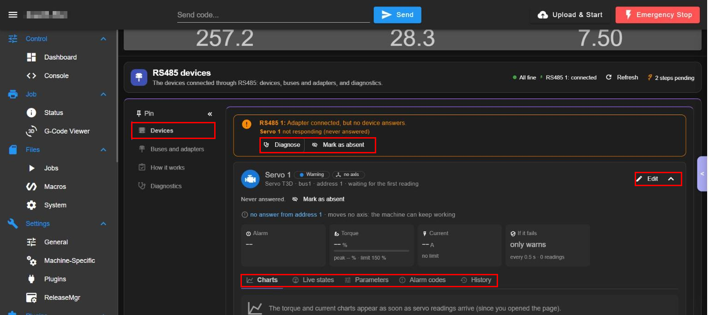
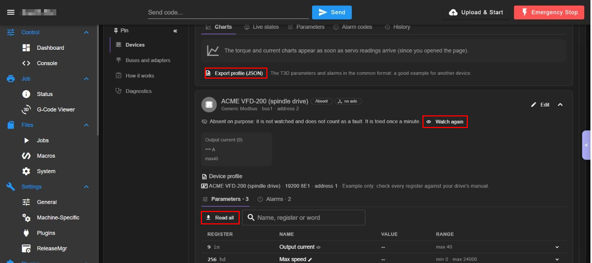
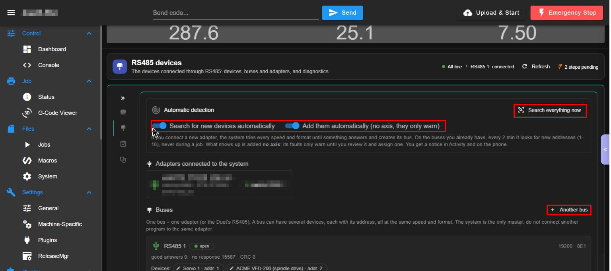
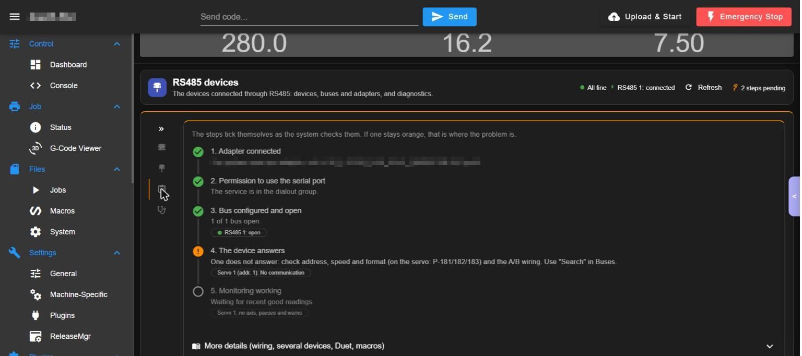
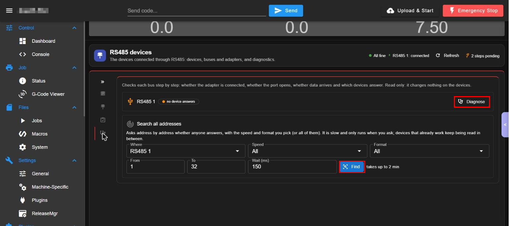

# WorkshopRS485 (RS485 devices)

Page `/Plugins/RS485` ("RS485 devices"). Talks to equipment on an RS485 / Modbus bus: servos (the T3D servo here), spindle drives (VFD), meters. It finds adapters and devices by itself, shows torque, current and alarm codes live, keeps a history, reads and writes registers by hand, imports and exports device profiles and has a step-by-step diagnostic. It has its own backend (`main.py`, pyserial) and depends on the System service.

Version documented: 2.6.x on DWC 3.6.3.

## 1. Requirements

1. WorkshopService running. 2. `pyserial >= 3.5` (installed by DSF from the plugin manifest into the plugin's own venv). 3. An RS485 adapter: USB (FTDI etc., shows as `/dev/ttyUSB0`) or the RS485 port of the Duet. 4. The plugin's service user in the group `dialout` (step 2 of the checklist verifies it). 5. Only one master per bus: do not connect another program to the same adapter.

## 2. Install

1. Install WorkshopService. 2. DWC > Settings > Plugins > Install `WorkshopRS485-<ver>.zip`. Start. 3. Reload DWC; *Plugins > RS485* appears. 4. Verify in the page: header "All fine", chip "RS485 1: connected", start-up chip ("2 steps pending" until a device answers). In the service page the start-up list shows "RS485 devices: n of 6 steps pending".

## 3. Functions

The page is "RS485 devices" (side menu: Plugins > RS485). Its side bar has four entries: Devices, Buses and adapters, How it works, Diagnostics (icons only when collapsed with the double arrow). Red rectangles mark the control described. The adapter name and serial number are blurred.

### Page header

#### State chips, Refresh and pending steps
- What: "All fine" (or a warning), "RS485 1: connected" (the state of the first bus), the button "Refresh" and "N steps pending" (setup steps not done).
- Where: top right of the page header (any picture).
- How: press "Refresh" to read the state again.

### Devices

Picture 1: the orange banner with "Diagnose" and "Mark as absent", the card "Servo 1" with "Edit", and its tabs (red rectangles).

#### Banner: adapter connected but no device answers
- What: tells which bus has an adapter and which device does not answer ("Servo 1 not responding (never answered)").
- Where: top of the Devices entry (picture 1).
- How: press "Diagnose" to open the step-by-step check, or "Mark as absent".
- Watch out: a device that moves no axis never stops the machine.

#### Mark as absent / Watch again
- What: "Mark as absent" tells the system the device is absent on purpose: it is not watched and does not count as a fault; it is tried once a minute. "Watch again" undoes it.
- Where: banner and device card; "Watch again" on an absent device (picture 2).
- How: 1. Press "Mark as absent". 2. Later press "Watch again".
- Watch out: it changes the monitoring.

#### Device card (state, Edit, collapse)
- What: one card per device: name, chips (Warning, no axis), model, bus, address and the last answer; "no answer from address 1 - moves no axis: the machine can keep working"; "Edit" changes the device; the arrow collapses the card.
- Where: picture 1, below the banner.
- How: press "Edit" to change the device (name, bus, address, axis and what happens on a fault).
- Watch out: See Roles.

#### Tiles: Alarm, Torque, Current, If it fails
- What: Alarm, Torque (peak and limit 150 %), Current and "If it fails" (here "only warns", read every 0.5 s, with the number of readings).
- Where: row of tiles in the card (picture 1).
- How: read only.

#### Tabs: Charts, Live states, Parameters, Alarm codes, History
- What: Charts of torque and current (they appear when readings arrive), Live states, Parameters of the device, the list of Alarm codes and the History of events.
- Where: tab row of the card (red rectangle, picture 1).
- How: press a tab.

Picture 2: the second device (absent on purpose) with its profile, "Read all" and the register table; "Export profile (JSON)" at the top.

#### Export profile (JSON)
- What: exports the parameters and alarms of the device in the common format (the T3D profile is a sample for another device).
- Where: line under the charts of the card (red rectangle, picture 2, top).
- How: press it to download the JSON file.
- Watch out: it downloads a file.

#### Device profile and register table
- What: the profile of the device (model, speed and format, address; "Example only: check every register against your drive's manual"); tabs Parameters and Alarms; a table with register, name, value and range.
- Where: lower part of the device card (picture 2).
- How: open a row with its arrow to see its details.

#### Read all and search
- What: "Read all" reads every parameter of the profile; the search box filters by name, register or word.
- Where: above the table (red rectangle, picture 2).
- How: press "Read all".
- Watch out: it only reads.

#### Read or write a register by hand
- What: fields register, function and value with the buttons Read and Write, for any register.
- Where: inside the device card, in the profile area (scroll down).
- How: 1. Choose the register and the function. 2. Press Read, or type a value and press Write.
- Watch out: Write changes the drive (it can start a motor or change its limits): use it only with the drive manual and the machine safe.

#### Identify the device and Explore registers
- What: "Which device it is / Identify" asks the device for its identity (Modbus function 43). "Explore registers" reads a range and lists the registers that exist without changing anything; one tap adds a register to the watched list.
- Where: inside the device card, profile area (scroll down).
- How: choose the range, press explore, then add the registers you want.

#### Add device and Add from a JSON profile
- What: "Add device" creates a device by hand (name, bus, address, profile); "Add from a JSON profile" loads a profile file.
- Where: bottom of the Devices entry.
- How: 1. Press the button. 2. Fill the data or choose the file. 3. Save.
- Watch out: a new device has no axis until you assign one.

### Buses and adapters

Picture 3: "Automatic detection" with its two switches and "Search everything now", the adapters list (blurred) and "Buses" with "+ Another bus" (red rectangles).

#### Automatic detection switches
- What: "Search for new devices automatically": plugging a new adapter makes the system try every speed and format until something answers and create its bus; on existing buses, every 2 minutes it looks for new addresses (1-16), never during a job. "Add them automatically (no axis, they only warn)": what shows up is added with no axis and you get a notice in Activity and on the phone.
- Where: top card (red rectangle, picture 3).
- How: press each switch.
- Watch out: review a found device and assign its axis before relying on it.

#### Search everything now
- What: runs the search at once on all adapters.
- Where: top right of the card (red rectangle, picture 3).
- How: press it and wait; it may take a while.

#### Adapters connected to the system
- What: lists the USB serial adapters the system sees, with port, chip and driver, and which bus uses each.
- Where: card under the detection (picture 3; the adapter name is blurred).
- Watch out: the name contains the adapter serial number: blur it before sharing a picture.

#### Buses
- What: a bus is one adapter (or the Duet's RS485): name, kind, port, speed and format (here 19200, 8E1), counts of good answers / no response / CRC and the devices on it; "Find devices (1-32)" looks for addresses; "+ Another bus" adds a bus.
- Where: card "Buses" (picture 3, bottom).
- How: 1. Press "+ Another bus" and fill name, adapter, speed and format. 2. Press "Find devices (1-32)" on a bus to search.
- Watch out: the system is the only master: do not connect another program to the same adapter.

### How it works

Picture 4: the start-up checklist.

#### Start-up checklist
- What: five steps that tick themselves: 1 adapter connected, 2 permission to use the serial port (the service is in the `dialout` group), 3 bus configured and open, 4 the device answers (orange: check address, speed and format - on the servo P-181/182/183 - and the A/B wiring), 5 monitoring working.
- Where: entry "How it works" (picture 4).
- How: read it from the top; the first orange step is where the problem is.

#### More details
- What: a fold "More details (wiring, several devices, Duet, macros)".
- Where: bottom of the checklist (picture 4).
- How: press it to unfold.

### Diagnostics

Picture 5: "Diagnose" per bus and the card "Search all addresses".

#### Diagnose a bus
- What: checks step by step whether the adapter is connected, the port opens, data arrives and which devices answer. It reads only: it changes nothing on the devices.
- Where: one row per bus with the button "Diagnose" (red rectangle, picture 5, top).
- How: press "Diagnose" and read the result.

#### Search all addresses
- What: asks address by address whether anyone answers, with the speed and format you pick (or all). It is slow ("takes up to 2 min") and only runs when you ask; devices already working keep being read in between.
- Where: card "Search all addresses": Where (bus), Speed, Format, From, To, Wait (ms) and the button "Find" (red rectangle, picture 5).
- How: 1. Choose the bus, speed and format. 2. Set From and To (default 1 to 32). 3. Press "Find".

## 4. Settings

| Setting | Meaning | Default | If wrong |
|---|---|---|---|
| Bus: port, speed, format | Serial line | 19200 8E1 | Wrong values: no answers (CRC errors) |
| Device address and profile | Modbus slave | per device | Wrong address: no answers |
| Axis of a device | Which axis it protects | none | With an axis, its failures act on the machine |
| If it fails | Only warn / pause / stop | Only warn | "stop" with a flaky cable stops jobs |
| Read period | Polling | 0.5 s | Too fast loads the bus |
| Auto detection | Find adapters and devices | on, add without axis | Off: manual setup only |
| Mark as absent | Not watched, tried once a minute | off | Hides real failures |

## 5. Roles

Own table `OP_ROLES` + `ACTION_ROLES` (`rs485_access.py`, equal to the service's): reading state: any role; reading registers: operator; writing registers, adding or editing devices, imports: administrator; a new action stays administrator-only until classified. Without users: open.

## 6. API operations used

RS485 backend actions (devices, buses, read/write register, scan, diagnose, profile import/export) under `/machine/WorkshopRS485/...`, plus `profile.get`, `settings.*` and the shared notifications of the service (alerts to Activity and phone).

## 7. Troubleshooting

1. "Adapter connected, but no device answers": check address, speed and format in the servo (P-181/182/183), A/B wiring (swap A and B), power, and use Find.
2. Step 2 fails: the service user is not in group `dialout`.
3. A toast about `.../WorkshopRS485/venv/lib/python3.13/site-packages`: DSF is reporting the plugin's Python environment; if pyserial is missing reinstall the plugin (stop it first).
4. Two programs on one adapter: only one master; stop the other.
5. Device needed no more: "Mark as absent" instead of deleting it.

<!-- permissions:start -->

## Permissions and what it changes

Risk: **High (own Python process; writes to an industrial bus; can send M25 / M112 on a device fault)**. Read this before installing; the full document is `security.md` of the Workshop plugins.

**DSF permissions** (DSF shows them and you approve them when you install; the zip asks for nothing else):

| Permission | What it lets the plugin do |
|---|---|
| `commandExecution` | send G-code to the board |
| `codeInterceptionReadWrite` | intercept G-code (M3/M4/M5, a device fault) and let it through or change it |
| `objectModelReadWrite` | read the state of the machine and publish its own data in it |
| `fileSystemAccess` | read and write files outside the DSF folders (keys, camera files) |
| `registerHttpEndpoints` | answer on its own address (an API endpoint under /machine/<Id>/) |
| `networkAccess` | open network connections (notices, the meter, the camera, the service API) |

**Depends on:** `WorkshopService` (install it first, uninstall it last).

**Runs a program on the Pi:** `main.py` as the `dsf` user (restarted by DSF if it stops).

**Files it writes:**
- its devices, buses and profiles under `0:/sys/workshop/`

**What it needs outside the zip** (each one is a separate step you do on purpose and can undo):
- the `dsf` user must be in the `dialout` group to open the USB-RS485 adapter
- Python package `pyserial` in its own venv

**Safety notes:**
- Its API applies the roles before any write to a bus. A device with no axis only warns: it never pauses a job.

Uninstalling removes the plugin folder; your data in `0:/sys/workshop/` and `/opt/dsf/conf/workshop-*.json` stays.

<!-- permissions:end -->

## 8. Limits

Modbus RTU only; one master per bus; registers shown in the sample profile (ACME VFD-200) are an example: verify against the real manual before writing; a Duet-side RS485 port needs the Duet to be free.

